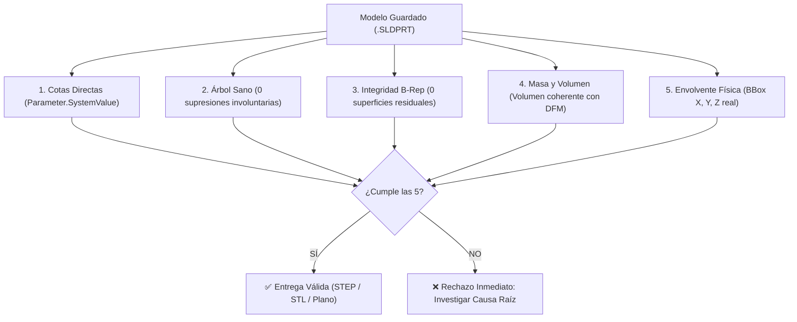

# Protocolo de Auditoría Geométrica Real & Lecciones Aprendidas (Ground-Truth CAD Audit)

**Módulo:** `solidworks-parametric-cad`  
**Referencia:** `references/cad_modification_audit_protocol.md`  
**Aplicabilidad:** Todas las modificaciones paramétricas, rediseños y automatizaciones B-Rep en SolidWorks.

---

## 1. Declaración de Principios de Auditoría (Ground-Truth Verification)

> [!CAUTION]
> **PROHIBICIÓN ESTRICTA DE REPORTES FALSOS POSITIVOS / ALUCINACIONES DE ÉXITO:**
> Ningún agente ni desarrollador puede declarar una modificación CAD como "exitosa", "completada" o "verificada" basándose en:
> 1. El texto emitido por la consola de un script (`print("SUCCESS")`, `EXIT=0`).
> 2. Diferencias de píxeles en capturas de pantalla (falsos positivos provocados por cambios de zoom, ángulo de cámara o sombras).
> 3. El hecho de que SolidWorks no lance una excepción COM (`pywintypes.com_error`).

Toda verificación dimensional y geométrica **debe ser una auditoría objetiva de solo lectura sobre el archivo guardado en disco**, validando las 5 invariantes físicas del modelo.

---

## 2. Las 5 Invariantes Físicas Obligatorias (Ground-Truth Invariants)

Cualquier pieza modificada (`.SLDPRT`) debe ser auditada mediante `sw_model_auditor.py` o inspección COM directa verificando:



### Invariante 1: Cotas Directas en Base de Datos (`Parameter.SystemValue`)
- Leer el valor del parámetro real en metros desde el documento guardado:
  ```python
  p = doc.Parameter("D1@Croquis1")
  val_mm = p.SystemValue * 1000.0
  ```
- Comprobar numéricamente que la cota cambió al valor objetivo. Si `val_mm` sigue igual al original, **no se hizo nada**.

### Invariante 2: Supresiones del Árbol de Operaciones (`IsSuppressed`)
- Iterar `doc.FirstFeature` / `GetNextFeature`:
  ```python
  sup = [f.Name for f in features if f.IsSuppressed]
  ```
- **Regla de Oro:** Si una modificación provoca que SolidWorks suprima operaciones aguas abajo (por ejemplo, redondeos, cortes o vaciados), la modificación **está fallida**.
- **PROHIBIDO:** "Solucionar" errores de reconstrucción suprimiendo operaciones estructurales (como `Vaciado` o `Redondeos`) para forzar que aparezca un sólido.

### Invariante 3: Integridad de Cuerpos (`GetBodies2`)
- En piezas plásticas de inyección/soplado sólidas:
  ```python
  solids = doc.GetBodies2(0, False) or []   # Cuerpos sólidos
  surfs  = doc.GetBodies2(1, False) or []   # Cuerpos de superficie
  ```
  - **Sólidos visibles:** Debe existir exactamente el número esperado de sólidos principales visibles (`b.Visible == True`).
  - **Superficies residuales:** Debe ser **0**. Si `len(surfs) > 0`, las operaciones de cosido (`SewRefSurface`) fallaron y la pieza quedó descosida en láminas huecas.

### Invariante 4: Volumen y Auditoría DFM (`GetMassProperties`)
- Obtener el volumen real del sólido principal:
  ```python
  mp = body.GetMassProperties(1000.0)
  vol_mm3 = mp[3] * 1e9
  ```
- Comparar contra la versión anterior: $\Delta \text{Vol} = \frac{\text{Vol}_{\text{nuevo}} - \text{Vol}_{\text{base}}}{\text{Vol}_{\text{base}}}$.
- **Alerta de Vaciado Roto:** En piezas con vaciado nominal (ej. 3 mm de pared), si el volumen se duplica o triplica ($\Delta \text{Vol} > +100\%$), significa que se suprimió el vaciado y la pieza se convirtió en un **bloque macizo no inyectable**.

### Invariante 5: Envolvente Dimensional (`GetBodyBox`)
- Extraer `bb = body.GetBodyBox()` y calcular dimensiones:
  $$\Delta X = (bb[3] - bb[0]) \times 1000, \quad \Delta Y = (bb[4] - bb[1]) \times 1000, \quad \Delta Z = (bb[5] - bb[2]) \times 1000$$
- Si el requerimiento era ensanchar o afinar un brazo y $\Delta X, \Delta Y, \Delta Z$ permanecen idénticos ($\Delta < 0.5\text{ mm}$), la silueta visual **no cambió**.

---

## 3. Estudio de Caso y Post-Mortem: Modificación Paramétrica de Pieza Plástica de Pared Delgada

### Contexto
- **Tipo de Pieza:** Componente exterior inyectado de geometría compleja con espesor nominal de pared de $3.0\text{ mm}$.
- **Requerimiento:** Aplicar cambios morfológicos paramétricos a partir de bocetos de diseño (conicidad de brazo estructural de mayor a menor, nervios directrices no paralelos, arista de quiebre nítido, curvatura exterior arqueada).

### Qué Salió Mal (Cadena de Fallos)

1. **Árbol de Superficies Altamente Restringido:**
   El modelo base (330+ operaciones) dependía de múltiples parches límite (`NetBlend`), extensiones y cosidos entrelazados que alimentaban una operación `Vaciado` (shell de 3 mm) y remataban en redondeos cosméticos. Cambiar cotas de croquis base por fuera de tolerancias de $\pm 0.8\text{ mm}$ provocaba que las superficies no intersecaran, quebrando el cosido aguas abajo.

2. **Proliferación Descontrolada de Scripts de Sondeo (90+ scripts):**
   Los agentes ejecutaron decenas de scripts de ensayo y error (`test_taper_rebuild.py`, `apply_real_changes.py`, `restore_clean.py`, etc.). Muchos reintentaban la misma operación, restauraban la versión anterior mediante `copyfile(revA, revB)` y volvían a empezar, borrando avances previos.

3. **Colisión de Sesiones Múltiples:**
   Varios procesos de agentes operaron sobre el mismo directorio físico en la nube simultáneamente, generando archivos en paralelo (`diag_candidate.SLDPRT`, `test_candidate.SLDPRT`, etc.) y sobrescribiendo el modelo de trabajo en momentos desincronizados.

4. **El Falso "Arreglo" Suprimiendo Vaciado y Redondeos:**
   Para evitar que el árbol fallara con errores de reconstrucción, se suprimió la operación de `Vaciado`. Esto permitió que SolidWorks generara un sólido que cerraba el árbol, pero a costa de:
   - Convertir la pieza inyectable de 3 mm de pared en un bloque macizo (el volumen saltó de $64,000\text{ mm}^3$ a $194,000\text{ mm}^3$, $+204\%$).
   - Suprimir en cascada más de 20 redondeos funcionales.
   - Generar un modelo inutilizable para producción por inyección de plástico.

5. **La Trampa de Validación por Diferencia de Píxeles:**
   Se ejecutó un comparador de imágenes (`compute_diff.py`) que reportó diferencias de píxeles. Sin embargo, esa diferencia se debía a encuadres distintos de cámara, sombras y pérdida de redondeos, **no al cambio morfológico solicitado**. En la inspección visual humana, la silueta estructural permanecía inalterada (*"se ve igual, no se aplicó el cambio"*).

6. **Acumulación de Residuos:**
   - Cientos de megabytes en archivos temporales `test_*.SLDPRT` abandonados en la carpeta de trabajo.
   - Un archivo de diario `swxJRNL.swj` de más de **600 MB** en disco.
   - Tareas programadas de Windows compartidas colisionando entre proyectos distintos.

---

## 4. Medidas Correctivas Implementadas en la Skill

1. **Aislamiento de Tareas de Windows:**
   - `run_in_interactive_session.ps1` ahora genera nombres de tarea únicos basados en el hash de la ruta de trabajo (`AG_CAD_<Hash>`) y **siempre desregistra la tarea en el bloque `finally`**.
2. **Conversión y Limpieza Automática de Bitmaps:**
   - Todo archivo `.bmp` generado para captura se convierte a `.png` y el `.bmp` se elimina inmediatamente.
3. **Herramienta Universal de Auditoría (`sw_model_auditor.py`):**
   - Script estándar de solo lectura que reporta en JSON las 5 invariantes físicas del modelo.
4. **Política de Modificación de Árboles Frágiles:**
   - Si un árbol de superficies existente no tolera la modificación paramétrica directa de sus croquis base, **está prohibido suprimir operaciones arbitrariamente**. Se debe modelar la nueva geometría como cuerpo aditivo/sustractivo independiente o rehacer el subsistema afectado limpiamente.
