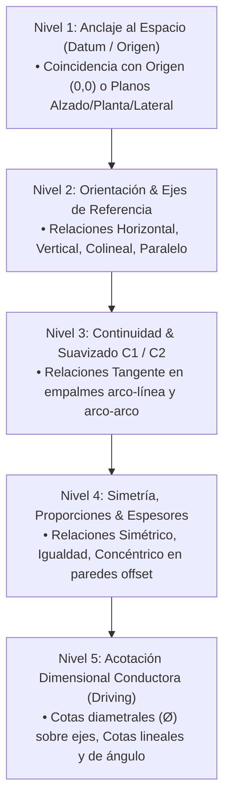
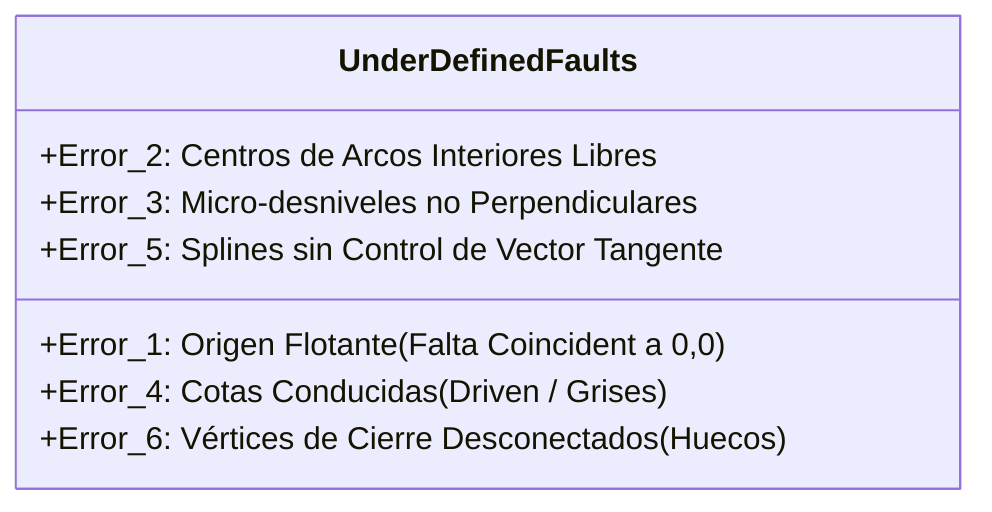

# Estándar de Ingeniería: Croquis 100% Totalmente Definidos (`Fully Defined`) en SolidWorks 2025

> [!DANGER]
> **NORMATIVA OBLIGATORIA DE CALIDAD CAD (CERO LÍNEAS AZULES)**
> En todo desarrollo CAD paramétrico en SolidWorks 2025, **NINGÚN croquis puede quedar Subdefinido (`Under Defined` / líneas azules)** ni Sobredefinido (`Over Defined` / líneas amarillas/rojas).
> 
> Esta regla aplica sin excepción a **TODO TIPO DE OPERACIÓN CAD**:
> - **Revoluciones:** Cuerpos de envase, botellas, tapas, émbolos, roscas axisimétricas.
> - **Extrusiones y Cortes:** Perfiles prismáticos, nervios de refuerzo, paredes de faldón, orejetas, calados.
> - **Barridos (Sweeps):** Filetes de roscas plásticas, cordones de soldadura, labios de estanqueidad, tuberías.
> - **Solevaciones (Lofts):** Secciones de transición (estadio a circular, elipse a rectángulo), fondos y hombros anatómicos.
> - **Curvas Guía & Croquis 3D:** Líneas directrices de botellas ergonómicas, hélices y desvanecimientos.

---

## 1. ¿Por Qué es Crítico el Estado `Fully Defined`?

1. **Estabilidad Paramétrica:** Un croquis con grados de libertad flotantes (azul) cambia de forma impredecible o se invierte (flip geométrico) cuando se actualiza una variable global en `EquationMgr`.
2. **Transferencia sin Errores a Moldes & CAM:** Las líneas no definidas provocan fallos en la generación de superficies B-Rep, desalineación de particiones de molde (`mould parting line`) y colisiones en mecanizado CNC de cavidades.
3. **Mantenibilidad Colaborativa:** Cualquier otro ingeniero o agente de IA que abra el archivo en SolidWorks podrá regenerar el árbol sin que las operaciones colapsen.

---

## 2. Jerarquía de Restricciones Matemáticas (The Constraint Hierarchy)

Para definir un croquis al 100% sin sobredefinirlo, se debe seguir estrictamente este orden de aplicación de restricciones:



| Nivel | Tipo de Restricción | Propósito Físico | Error Clásico Si Falta |
| :---: | :--- | :--- | :--- |
| **1** | `COINCIDENT` al Origen $(0,0)$ | Elimina los 2 grados de libertad de traslación global ($X, Y$). | El croquis completo flota y se desplaza al arrastrar cualquier punto. |
| **2** | `HORIZONTAL` / `VERTICAL` | Fija la orientación angular respecto a los ejes principales. | Las paredes verticales se inclinan al cambiar una cota. |
| **3** | `TANGENT` ($C^1$) | Garantiza continuidad tangencial sin esquinas vivas de concentración de esfuerzos. | Grietas en molde de soplado/inyección; reflejos con saltos ópticos. |
| **4** | `CONCENTRIC` / `EQUAL` | Gobierna el espesor de pared entre perfil interior y exterior. | Paredes con espesor oscilante o centros flotantes desconectados. |
| **5** | Cotas Conductoras (`Driving`) | Asigna el valor métrico exacto a las distancias independientes restantes. | Dimensiones gobernadas por el azar del cursor del ratón. |

---

## 3. Protocolo Específico por Tipo de Operación CAD

### 3.1 Croquis de Revolución (`FeatureRevolve2` / `InsertCutRevolve`)
Aplica a: Envases de vidrio, botellas plásticas, tarros, tapas cilíndricas.

```
       [Labio Superior Horizontal] --- (W_seal >= 1.5 mm, Cota Ø interior I)
      /                           \
  [R_ext]                       [R_int Concéntrico]
     |                              |
[Boca Finish Ø_E]             [Cuello Interno Ø_I]
     |                              |
[Anillo Transferencia]              |  (Espesor t_cuello)
     |                              |
 [Hombro R_hombro]             [Hombro Int Concéntrico]
     |                              |
 [Cuerpo Ø_cuerpo]             [Cuerpo Int Concéntrico] (Espesor t_pared)
     |                              |
  [Talón R_talón]               [Talón Int Concéntrico]
     |                              |
[Anillo Apoyo Y=0]            [Fondo Int Y=t_fondo] (Espesor t_fondo >= 1.5*t_pared)
      \                            /
    [Domo Picada / Push-Up concéntrico centrado en X=0]
```

**Reglas Inquebrantables de Revolución:**
1. **Eje Central:** Trazar una línea constructiva (`ConstructionGeometry = True`) vertical desde el Origen $(0,0,0)$ hasta la altura máxima $H_{\text{total}}$. Aplicar `COINCIDENT` al Origen y `VERTICAL`.
2. **Cierre Topológico Estricto:** Los extremos superior e inferior del contorno deben terminar exactamente sobre el eje vertical ($X = 0$) con relación `COINCIDENT`.
3. **Paredes Curvas Interiores:** El contorno interior **NUNCA** debe llevar cotas de posición ($X, Y$) en sus centros. Debe utilizar la restricción `CONCENTRIC` con el arco exterior correspondiente y una única cota de espesor radial:
   $$R_{\text{int}} = R_{\text{ext}} - t_{\text{pared}}$$
4. **Acotación Diametral:** Seleccionar la entidad $\to$ seleccionar el eje central de construcción $\to$ cruzar el cursor al otro lado del eje para acotar como **Diámetro ($\varnothing$)**.
5. **Fondo Reforzado:** El espesor de fondo debe acotarse explícitamente entre la cara de apoyo ($Y=0$) y la cara interna ($Y = t_{\text{fondo}}$).

---

### 3.2 Croquis de Extrusión & Corte Prismático (`FeatureExtrusion3` / `FeatureCut4`)
Aplica a: Nervios estructurales, fondos hexagonales, orejetas, bridas, calados de faldón.

**Reglas Inquebrantables de Extrusión:**
1. **Anclaje al Plano Medio o Simetría:** Si la pieza es simétrica, centrar el croquis en el Origen utilizando relaciones `SYMMETRIC` respecto a los planos principales (`Alzado` o `Vista Lateral`) o una línea constructiva que pase por el punto medio (`MIDPOINT`).
2. **Envolvente Exterior:** Acotar primero las dimensiones globales de ancho ($W$) y largo ($L$).
3. **Taladros y Vaciados Internos:** La posición de todo taladro o cavidad debe fijarse con 2 cotas ortogonales ($X, Y$) respecto a las aristas de referencia o al Origen, más 1 cota de diámetro ($\varnothing$) o radio ($R$).
4. **Uso de Relaciones Geométricas sobre Cotas Numéricas:** Si dos nervios tienen el mismo espesor, usar `EQUAL` en vez de colocar dos cotas independientes de $2.0\text{ mm}$. Si dos ranuras están alineadas, usar `COLLINEAR`.

---

### 3.3 Croquis de Barrido (`InsertSweepRef` / `FeatureSweepCut`)
Aplica a: Filetes de roscas exteriores e interiores (SPI 400/410/415), tuberías, juntas tóricas, manijas.

**Reglas Inquebrantables de Barrido:**
1. **Perfil de Rosca / Sección:**
   - Debe croquizarse en un plano perpendicular al inicio de la trayectoria o hélice.
   - El punto de penetración del perfil debe fijarse a la trayectoria mediante la restricción **`PIERCE` (Perforar)**.
   - El perfil de rosca plástica (Buttress Estilo "M") debe estar completamente cerrado y definido con sus ángulos de flanco ($45^\circ$ empuje, $10^\circ$ guía), altura de filete, radio de cresta y radio de raíz.
   - **Solapamiento DFM Obligatorio:** En roscas exteriores/interiores, el perfil del filete debe penetrar $0.3\text{ - }0.4\text{ mm}$ en el cuerpo base (`overlap`) para evitar aristas de espesor cero (`Zero-thickness geometry error`).
2. **Trayectoria / Hélice:**
   - Si la trayectoria se deriva de una hélice (`FeatureHelix`), el croquis circular base que genera la hélice debe tener su centro `COINCIDENT` con el eje del cuello y cota diametral $\varnothing = D_{\text{cuello}}$.

---

### 3.4 Croquis de Solevación / Loft (`InsertLoftRef` / `InsertCutBlend`)
Aplica a: Envases oblongos/estadio (Nutella), botellas con transición de base ovalada a boca circular, transiciones aerodinámicas.

**Reglas Inquebrantables de Solevación:**
1. **Alineación de Centros en Cada Plano:** Cada estación de corte (estadio, elipse, círculo) situada en un plano desplazado (`Plano_Y...`) debe tener su centro geométrico estrictamente `COINCIDENT` con el eje vertical $Y$ que pasa por el Origen.
2. **Secciones Estadio (Oblongo):**
   - No usar splines libres para formas de estadio. Utilizar la combinación paramétrica estandarizada: 2 líneas rectas horizontales paralelas + 2 arcos semicirculares tangentes en los extremos.
   - Restricciones requeridas:
     - Línea superior horizontal `HORIZONTAL`.
     - Línea inferior horizontal `HORIZONTAL`.
     - Centros de los arcos laterales sobre la línea media o eje $X$.
     - Radios laterales con relación `EQUAL`.
     - Cota de ancho mayor ($W_X$) y cota de profundidad menor ($D_Z$).
3. **Curvas Guía (Guide Curves):**
   - Si se usan curvas guía para gobernar el contorno del hombro o la cintura, cada vértice o punto de cuadrante de las secciones debe tener la relación **`PIERCE` (Perforar)** con la curva guía en el plano correspondiente.
   - La curva guía debe tener tangencia vertical (`TANGENT` a una línea constructiva vertical) en el arranque y en la llegada para garantizar continuidad $C^1$.

---

## 4. Los 6 Errores Clásicos que Dejan Croquis Subdefinidos (`Under Defined`)



1. **El Origen Flotante:** El diseñador dibuja el contorno cerca del origen visual pero no aplica la restricción física `COINCIDENT` entre el primer vértice y el punto `Origen` de SolidWorks.
2. **Centros de Arcos Desconectados:** Se traza un arco de hombro o talón interior y se acota su radio, pero el centro $(X_c, Y_c)$ queda libre para moverse en diagonal. *Solución:* Relación `CONCENTRIC` con el arco exterior.
3. **Micro-desniveles en Líneas Supuestamente Horizontales:** Un segmento que parece horizontal tiene un desnivel de $0.01\text{ mm}$ (como el segmento #31 en P1). SolidWorks no le asigna `HORIZONTAL` automáticamente y queda con 1 grado de libertad angular. *Solución:* Forzar explícitamente `HORIZONTAL`.
4. **Cotas Conducidas en Vez de Conductoras:** Cuando hay conflicto de restricciones, SolidWorks convierte la cota en gris (conducida / driven), dejando el parámetro sin gobierno matemático.
5. **Splines sin Restricción de Polígono de Control:** Dibujar un spline pasando por 3 puntos sin restringir la magnitud y el ángulo de los tiradores de tangencia en los extremos.
6. **Micro-huecos de Cierre en el Eje:** El punto superior de la boca no coincide con $X=0$, o el fondo no toca el eje vertical, impidiendo que SolidWorks reconozca un contorno cerrado sólido.

---

## 5. Implementación Automatizada en Python COM (`pywin32`)

Para garantizar por código que un croquis quede 100% `Fully Defined`, se debe seguir este flujo en la API COM de SolidWorks:

```python
def fully_define_active_sketch(doc):
    """
    Fuerza a SolidWorks a resolver y validar que el croquis este 100% Fully Defined.
    Retorna True si el estado es swSketchFullyConstrained (3).
    """
    sk = doc.SketchManager.ActiveSketch
    if not sk:
        return False
    
    # 1. Resolver relaciones geometricas pendientes
    doc.SketchManager.FullyDefineSketch(
        True,   # Entities to fully define: True = All entities
        True,   # Apply constraints
        1,      # Relations to add (1 = standard geometric relations)
        True,   # Apply dimensions
        1,      # Linear dimension scheme: 1 = Baseline, 2 = Chain, 3 = Ordinate
        None,   # Horizontal datum entity
        1,      # Angular dimension scheme
        None,   # Vertical datum entity
        1,      # Dim type
        1       # Placement
    )
    
    # 2. Consultar el estado estricto del croquis
    # swConstraintStatus_e:
    # 0 = swSketchNotSolved
    # 1 = swSketchOverConstrained
    # 2 = swSketchUnderConstrained
    # 3 = swSketchFullyConstrained (OBJETIVO OBLIGATORIO)
    status = sk.GetConstrainedStatus()
    return status == 3
```

---

## 6. Lista de Chequeo Obligatoria Pre-Entrega

Antes de registrar cualquier archivo `.SLDPRT` o dar por finalizado un modelo:

- [ ] **Inspección Visual del Árbol de Operaciones:** No debe aparecer el signo menos `(-)` al lado del nombre de ningún croquis (e.g. `(-)Croquis1` indica subdefinido). Todos los croquis deben estar limpios sin prefijo `(-)`.
- [ ] **Color en Pantalla:** Al editar el croquis, el 100% de los segmentos y vértices deben ser de color **NEGRO**. Ninguna entidad en **AZUL**.
- [ ] **Auditoría con `sw_model_auditor.py`:** El informe de auditoría debe confirmar:
  ```json
  "under_defined_sketches": [],
  "over_defined_sketches": [],
  "verdict": "HEALTHY"
  ```
- [ ] **Comprobación de Arrastre (Drag Test):** Al tomar cualquier vértice o línea con el ratón y arrastrarlo, no debe moverse ni cambiar su forma.
